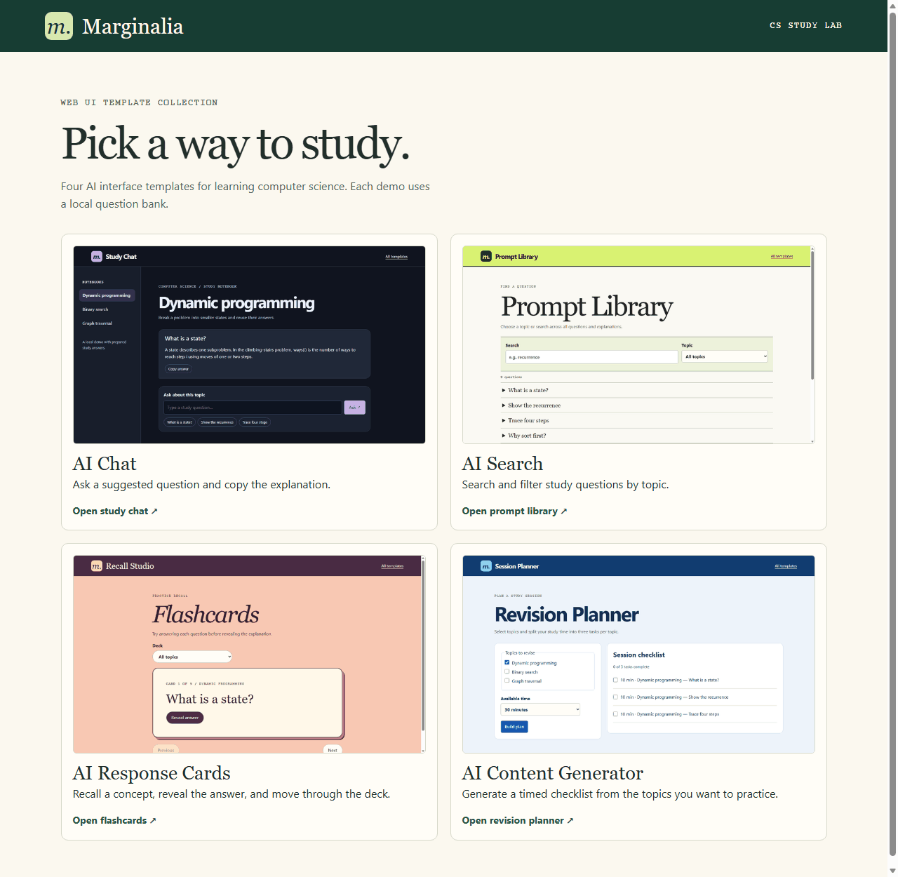

# Marginalia | CS Study Lab

**Assignment 2 · Web UI Template Collection**  
**Individual submission:** Charan Sai Teja Mannemala

**Selected category:** AI Interfaces

Marginalia demonstrates four interactive study interfaces in HTML, CSS and vanilla JavaScript. All explanations come from a local question bank.

## Open the project

Download or clone the repository and open `index.html` in a browser. Select any template on the home page. No server, account or packages are required.

| Template | What to demonstrate |
| --- | --- |
| AI Chat · Study Chat | Open Binary search, select **Trace a search**, and press **Ask**. Switch notebooks and return to see the conversation remain in place during the session. |
| AI Search · Prompt Library | Filter by topic or search for a word such as **recurrence**. Expand a result to read its explanation. |
| AI Response Cards · Flashcards | Reveal the answer, then select **Next**. Choose a topic to focus the deck. |
| AI Content Generator · Revision Planner | Choose topics and a duration, build a timed plan, then check a task to update progress. |

Study Chat uses a dark conversation workspace. Prompt Library uses a lime-accented editorial search layout. Recall Studio uses stacked peach and plum cards. Session Planner uses a blue planning dashboard with a checklist beside the controls on desktop. Shared layout rules live in `style.css`, template-specific styles in `themes.css`, and study data in `topics.js`. The home page links to each standalone template. At phone widths the template cards stack and the Study Chat notebook controls move above the conversation.

## Design references

- [IBM Carbon left panel guidance](https://v10.carbondesignsystem.com/components/UI-shell-left-panel/usage/) describes navigation for frequently switched destinations. Study Chat applies that pattern to notebooks.
- [Android Developers chip guidance](https://developer.android.com/develop/ui/compose/components/chip) describes contextual suggestions. Study Chat uses editable prompt suggestions before submission.

## Previews

## GitHub workflow

Use the repository’s **Pull requests** tab to see the original Study Chat contribution, the mobile fix and the expansion to four templates.

