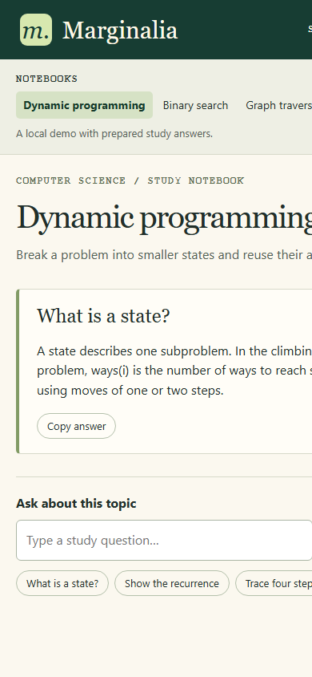

# Marginalia · Study desk

**Assignment 2 · UI Template Collection Hackathon**  
**Project name** Marginalia  
**Team member** Charan Sai Teja Mannemala (individual submission)  
**Selected UI topic** AI Interfaces

Marginalia is a browser-based study desk for three computer science topics. It demonstrates how a learner can move between conversations, compose a question and reuse an answer. All answers are prewritten. There is no model, account, API key or network request. The conversation lasts until the page is refreshed.

## Run locally

Extract the ZIP and open `index.html` in a modern browser. The HTML, CSS and both JavaScript files must stay together. No packages or build step are required.

## Implemented UI templates

| Template | How to try it | Where to look in the code |
| --- | --- | --- |
| Conversation sidebar | Switch notebooks and return to an earlier conversation. Each notebook retains its own messages during the session. | The notebooks navigation in index.html and openNotebook in script.js |
| Prompt suggestion composer | Choose a suggested question, edit it, and press Enter or Ask. An unrecognized question displays a guide to the supported prompts. | The composer form in index.html and the suggestions in openNotebook |
| AI response card | Read the question and answer together. Select Copy answer to copy the text. If the browser restricts clipboard access, the text is selected for manual copying. | renderCard and copyAnswer in script.js |

## Topic research

A conversation sidebar gives users a stable place to switch context. IBM Carbon describes its left panel as appropriate for frequent switching between secondary navigation items. Here the same idea is applied to notebooks. On a narrow screen the notebook choices move above the conversation so the answer keeps the available reading width. [IBM Carbon left panel guidance](https://v10.carbondesignsystem.com/components/UI-shell-left-panel/usage/)

Suggestion chips offer likely next actions near an input. Android's design guidance describes suggestion chips as contextual recommendations. In this implementation, each notebook offers different questions. Selecting a chip fills the input and leaves the learner free to edit before submitting. [Android Developers chip guidance](https://developer.android.com/develop/ui/compose/components/chip)

The response card keeps an individual question, answer and copy action together. This lets a student copy one explanation from a longer exchange. Our implementation combines all three patterns in an offline study desk and includes a worked example for each notebook.

## Technologies and reuse

HTML provides semantic navigation, a labelled form and a live conversation region. CSS handles the grid, small-screen layout and keyboard focus. Vanilla JavaScript renders notebook choices and response cards. To adapt the desk to another subject, edit the titles, introductions and question–answer pairs in topics.js. The sidebar and suggestions update from that data.

## Previews

## One-minute demonstration

1. Open Binary search. Choose **Trace a search** and press **Ask**. Read the index trace and copy the answer.
2. Switch to Graph traversal and return to Binary search. Point out that the previous question stays in that notebook.
3. Narrow the browser window. The sidebar becomes a row of notebook choices above the answer.
4. Show the actual feature branch, commits and pull request in the assigned repository once published. Explain any feedback and resulting changes.

## GitHub workflow

This standalone repository contains the work for an individual submission. The project is published on the `feature/marginalia-study-desk` branch. Open the pull request to see the changes proposed for `main`.

The assignment describes a team review and a fork of the assigned repository. For an individual submission using this standalone repository, confirm the submission arrangement and reviewer with the instructor.
